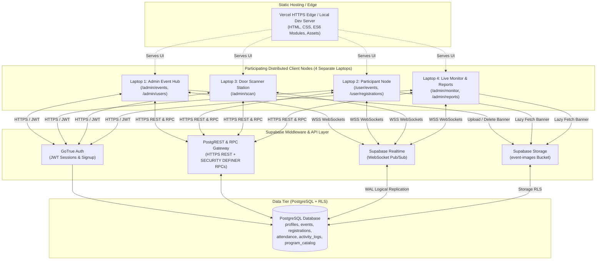
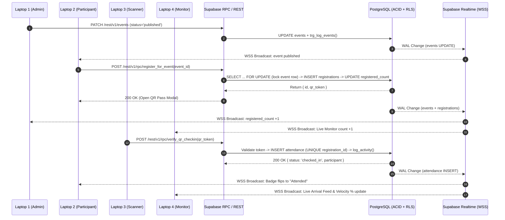
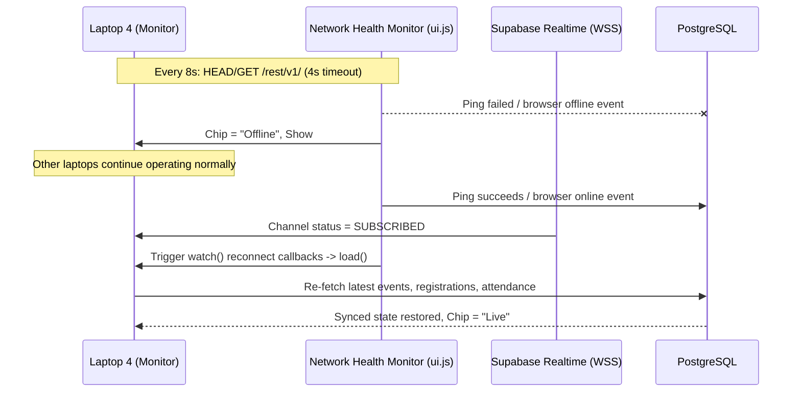
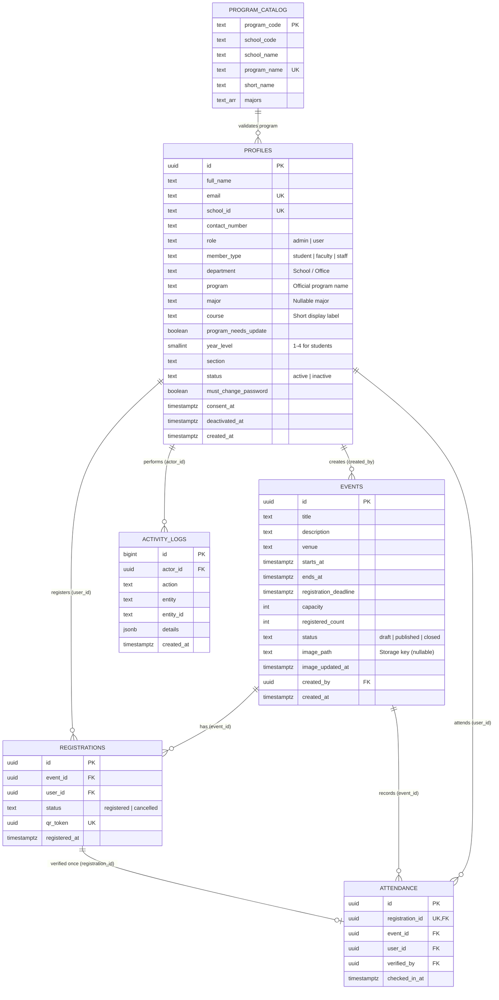

# EventSync — Final Project Documentation
**Course:** Parallel and Distributed Computing (PDC)  
**Project Type:** Development of an Interactive Distributed System  
**Approved System:** **EventSync** — Distributed Event Registration and Attendance Management System (BiPSU Main Campus Edition)

---

## Table of Contents
1. [Project Proposal (Three Proposed System Titles)](#1-project-proposal)
2. [System Documentation](#2-system-documentation)
3. [System Architecture Diagram](#3-system-architecture-diagram)
4. [Network Communication Diagram](#4-network-communication-diagram)
5. [Database Design & Entity Relationship Diagram (ERD)](#5-database-design--erd)
6. [Source Code Overview](#6-source-code-overview)
7. [User Manual (Installation, Configuration & Usage)](#7-user-manual)
8. [Testing Documentation (Automated & Multi-Laptop Distributed Tests)](#8-testing-documentation)
9. [Final Presentation, Failure & Recovery Demo, and Defense Q&A](#9-final-presentation--defense-guide)

---

## 1. Project Proposal

Per Section II (*Initial Project Proposal*), three (3) distributed system proposals were prepared. **Proposal 1 (EventSync)** is the approved and implemented system.

### Proposal 1 (Approved): EventSync — Distributed Event Registration and Attendance Management System
- **Proposed System Title:** EventSync: Distributed Event Registration and Attendance Management System
- **System Description:** A real-time, multi-node web application built for school and campus events (tailored for Biliran Province State University – Main Campus). Participants register online from their own devices to receive a tamper-proof UUID-based QR pass, door staff verify attendance using live QR camera scanning or manual token entry, and organizers monitor turnout, manage users, and export formatted A4 attendance sheets in real time.
- **Problem Addressed:** Traditional campus event registration relies on paper sign-up sheets or disconnected spreadsheets, causing long entrance queues, duplicate registrations, manual counting errors, inability to enforce seat capacities concurrently, and delayed post-event attendance reporting.
- **Main Features:**
  1. **Real-Time Event Management & Banners:** Admins create, edit, publish/unpublish, close, and delete events with 16:9 event poster/banner uploads, capacity limits, and registration deadlines.
  2. **BiPSU Main Campus Program Registration & QR Pass Generation:** Participants sign up with official BiPSU School/College, Program, Major, Year Level, and School ID, register for published events with atomic seat-lock checks, and receive a downloadable PNG QR pass.
  3. **Live QR Attendance Verification & Organizer Monitor:** Door scanner nodes verify QR passes (preventing duplicate check-ins), while the Live Monitor and all connected participant/admin devices update instantaneously via WebSockets.
  4. **Formatted Reports & User Administration:** Admins export A4-landscape Excel (`.xlsx`) and print-ready PDF attendance sheets with School/Office breakdowns, manage participant accounts, and inspect immutable activity logs.
- **Distributed System Application:** EventSync distributes operations across **four (4) separate computers/devices** (Admin Event Hub, Participant Registration Node, Door QR Scanner Station, and Organizer Live Monitor & Reporting Node) communicating over HTTPS (REST + Remote Procedure Calls) and persistent WebSockets (`supabase_realtime`) against a centralized PostgreSQL cloud database and object storage backend.

---

### Proposal 2 (Alternative): CampusQueue — Distributed Registrar & Cashier Service Queue System
- **Proposed System Title:** CampusQueue: Real-Time Distributed Student Service Queue and Counter Management System
- **System Description:** A multi-terminal queuing system where students obtain digital queue tickets from kiosk or mobile nodes, window tellers call and transfer tickets from counter workstations, and lobby display screens broadcast live queue numbers and estimated wait times.
- **Problem Addressed:** Physical crowding and confusion at campus registrar and cashier windows caused by uncoordinated manual paper numbering and lack of live counter visibility.
- **Main Features:**
  1. Digital ticket issuance by service category (Transcript, Enrollment, Cashier, Clearance).
  2. Teller workstation controls (Call Next, Hold, Transfer Window, Complete).
  3. Live lobby display board synchronized across all waiting-area monitors.
- **Distributed System Application:** Kiosk laptops, teller laptops, and lobby display laptops connect over the network to a central queue service and relational database using WebSockets and transactional row locking (`SELECT ... FOR UPDATE`) so no two tellers can claim the same ticket.

---

### Proposal 3 (Alternative): LabPulse — Distributed Computer Laboratory Inventory & Maintenance Tracker
- **Proposed System Title:** LabPulse: Distributed Laboratory Workstation Monitoring and Incident Reporting System
- **System Description:** A campus lab coordination system connecting student workstation nodes, lab technician laptops, and the department head dashboard to report hardware/software faults, track unit availability, and log maintenance resolution in real time.
- **Problem Addressed:** Delayed repair of broken laboratory PCs and peripherals due to verbal or paper-based incident reporting across multiple computer laboratories.
- **Main Features:**
  1. Per-unit status board (Operational, Needs Repair, Under Maintenance) across multiple labs.
  2. Instant fault ticket submission with severity tags and technician assignment.
  3. Live maintenance feed and exportable monthly lab readiness reports.
- **Distributed System Application:** Student lab computers, technician laptops, and the coordinator dashboard exchange state updates through REST/RPC calls and real-time Pub/Sub channels backed by a shared PostgreSQL database.

---

## 2. System Documentation

### 2.1 Objectives
- **General Objective:** Design and implement a functional, fault-tolerant distributed event registration and attendance system where multiple independent computers coordinate, exchange data in real time, and maintain strict transactional consistency.
- **Specific Objectives:**
  1. Separate system responsibilities across **4 distinct participating computers** (Event Management Node, Registration Node, Scanner Station Node, Live Monitor & Reporting Node).
  2. Enforce **server-authoritative concurrency control** using PostgreSQL row-level locks (`FOR UPDATE`) and `UNIQUE` constraints so simultaneous registrations never exceed capacity or create duplicate check-ins.
  3. Propagate every state change (event publishing, image updates, registrations, cancellations, check-ins, and new signups) across all connected devices in near-real time via WebSockets.
  4. Implement **network disconnection detection and automatic recovery** so nodes detect outages, inform the user, continue safe local operation/retry, and automatically resynchronize upon reconnection.

### 2.2 Scope and Limitations
- **Scope:**
  - Public landing page with live aggregate statistics and upcoming published events.
  - Participant portal: BiPSU Main Campus program-validated signup, profile editing, event browsing, 1-click registration/cancellation, downloadable QR pass modal, and attendance history.
  - Administrator portal: Event CRUD + 16:9 image upload/crop, assisted participant registration, live QR scanner (camera + manual token), real-time attendance monitor, A4 Excel/PDF attendance sheet exports with School/Office breakdown, activity logs, and participant user management.
- **Limitations:**
  - Camera-based QR scanning in mobile/laptop browsers requires a **secure context** (`https://` or `http://localhost`); non-localhost `http://` LAN connections must use manual QR token entry or the deployed HTTPS URL.
  - Designed for online/cloud-synced operation via Supabase; offline nodes display an offline banner and fall back to image placeholders until connectivity returns.

### 2.3 Multiple Computer Participation (4 Nodes)
| Node | Device | Assigned Role & Page | Contribution to Distributed System |
|---|---|---|---|
| **Laptop 1** | Organizer / Event Admin | `/admin/events` & `/admin/users` | Creates, edits, uploads banners for, and publishes events; manages participant accounts. Changes broadcast immediately to all other nodes. |
| **Laptop 2** | Participant Node | `/signup`, `/user/events`, `/user/registrations` | Registers participants, reserves seats atomically via RPC, receives unique QR passes, and reflects live seat/check-in updates. |
| **Laptop 3** | Door Scanner Station | `/admin/scan` | Verifies participant QR tokens via camera or manual entry (`verify_qr_checkin` RPC), preventing duplicate check-ins and broadcasting attendance events. |
| **Laptop 4** | Live Monitor & Reporting Hub | `/admin/monitor` & `/admin/reports` | Displays live registered/checked-in counters, arrival feeds, activity logs, and exports official A4 attendance sheets (`.xlsx` / PDF). |

### 2.4 Selected Distributed Architecture & Justification
EventSync implements a **Multi-Tier Client–Server & Cloud-Backed Pub/Sub Distributed Architecture**:
1. **Presentation Tier (Distributed Client Nodes):** Static HTML5/CSS3/ES6 JavaScript pages hosted on Vercel (production HTTPS) or `tools/dev-server.js` (`localhost:8080` for local testing). Each laptop/phone runs an independent browser client tailored to its role.
2. **Middleware & API Tier (Supabase PostgREST, GoTrue Auth, Realtime, Storage):**
   - **REST / PostgREST:** Standard CRUD queries protected by Row-Level Security (RLS).
   - **Remote Procedure Calls (RPC):** Atomic transactional operations (`register_for_event`, `cancel_registration`, `verify_qr_checkin`, `attendance_sheet`, `admin_list_users`, `public_landing_stats`, `public_upcoming_events`).
   - **WebSockets (`supabase_realtime`):** Pub/Sub change-data-capture streaming `INSERT`/`UPDATE`/`DELETE` events on `events`, `registrations`, `attendance`, `activity_logs`, and `profiles`.
   - **Object Storage (`event-images` bucket):** Public-read, admin-write storage for compressed 16:9 WebP/JPEG event banners.
3. **Data Tier (PostgreSQL):** Centralized relational database with ACID transactions, row-level locking, triggers, and RLS policies.

**Why this architecture is suitable:**
- Every participating laptop operates independently without relying on one peer laptop staying awake as a single point of failure.
- Heavy concurrency hazards (race conditions when 2 users claim the last seat, or 2 scanners scan the same QR simultaneously) are solved inside ACID PostgreSQL `SECURITY DEFINER` RPCs.
- WebSockets push updates to all 4 laptops automatically without manual page refreshes or polling.

### 2.5 Failure and Recovery Mechanisms
Implemented in `js/core/ui.js` (`startNetworkMonitor`, `watch`, `paint`):
1. **Disconnection Detection:**
   - Listens to browser `online` / `offline` events AND runs an **8-second health ping** (`GET /rest/v1/` with `apikey` and a 4-second abort timeout).
   - Updates the header status chip (`Live` -> `Connecting` -> `Offline`) and displays a visible `#netBanner` warning (`"You are offline — actions will not sync until reconnected."`).
2. **Operation During Outage:**
   - Remaining connected laptops continue operating normally against the cloud database.
   - On a disconnected node, any attempted write fails cleanly with a user-friendly error toast (never faking local success when unconfirmed by the server), and event images fall back to the built-in dark/crimson placeholder without broken image icons.
3. **Reconnection & Resynchronization:**
   - When connectivity returns (`online` event, successful health ping, or Realtime `SUBSCRIBED` recovery), all registered `watch()` callbacks automatically re-fetch fresh state (`load()`) from PostgreSQL so any missed transactions from other laptops are immediately reconciled.

---

## 3. System Architecture Diagram



---

## 4. Network Communication Diagram

### 4.1 Real-Time Multi-Laptop Transaction Flow (Registration & Door Check-In)


### 4.2 Disconnection & Automatic Recovery Flow


---

## 5. Database Design & ERD

### 5.1 Database Technology & Access Control
- **DBMS:** PostgreSQL (hosted on Supabase) with `pgcrypto` enabled.
- **Access Method:** Participating computers connect via HTTPS (PostgREST & RPC) using `@supabase/supabase-js` authenticated with JWTs from Supabase GoTrue Auth.
- **Security & Consistency Mechanisms:**
  - **Row-Level Security (RLS)** enabled on all tables (`profiles`, `events`, `registrations`, `attendance`, `activity_logs`) and `storage.objects`.
  - **Atomic `SECURITY DEFINER` RPCs:** All critical state transitions (`register_for_event`, `cancel_registration`, `verify_qr_checkin`, `admin_register_participant`, `attendance_sheet`, `admin_list_users`) execute inside PostgreSQL transactions with row locks (`FOR UPDATE`) and `UNIQUE` constraints (`registrations_unique_per_event`, `attendance.registration_id`).
  - **Role-Escalation & Profile Protection:** Triggers `prevent_role_change()`, `validate_profile_update()`, and column-level `GRANT UPDATE` ensure participants can never promote themselves to `admin` or alter `school_id`/`email`.

### 5.2 Entity Relationship Diagram (ERD)


### 5.3 Database Objects Summary
| Object | Purpose |
|---|---|
| `public.profiles` | User accounts (linked to `auth.users`), BiPSU program fields (`department`, `program`, `major`, `course`, `program_needs_update`), role, and active/inactive status. |
| `public.program_catalog` | Server-side catalog of the 7 BiPSU Main Campus Schools, 20 Programs, and Majors used by `resolve_program_selection()`. |
| `public.events` | Event schedule, venue, capacity, live `registered_count` (maintained by trigger), and optional `image_path` + `image_updated_at`. |
| `public.event_stats` (View) | Joins `events.*` with live `attended_count` for admin and participant views. |
| `public.registrations` | Links participants to events with `UNIQUE(event_id, user_id)` and unique `qr_token`. |
| `public.attendance` | Check-in records with `UNIQUE(registration_id)` preventing duplicate door scans. |
| `public.activity_logs` | Immutable audit trail written by triggers (`trg_log_events`) and `SECURITY DEFINER` RPCs. |
| `storage.buckets` (`event-images`) | Public-read, admin-write bucket (5 MB limit, `image/jpeg`, `image/png`, `image/webp` only). |

---

## 6. Source Code Overview

Repository root: `d:\eventsync`

```text
eventsync/
├── index.html                  # Public landing page (live stats + upcoming events row)
├── login.html                  # Authentication page (with password eye toggle)
├── signup.html                 # Public participant registration (BiPSU selector + validation)
├── config/
│   └── programs.js             # Single source of truth for BiPSU Schools, Programs & Majors
├── css/
│   └── theme.css               # Dark + Crimson theme, responsive tables/cards, uploader & selector UI
├── admin/
│   ├── events.html             # Admin Event CRUD + 16:9 image uploader/cropper
│   ├── registrations.html      # Admin Registrations list + assisted participant registration
│   ├── scan.html               # Door QR Scanner Station (camera + manual entry)
│   ├── monitor.html            # Organizer Live Monitor & arrival feed
│   ├── reports.html            # Per-event Attendance Sheet & Summary Excel/PDF exports
│   └── users.html              # Admin Users directory, filters, detail modal, Excel export
├── user/
│   ├── events.html             # Participant Browse Events (16:9 banners, Details modal, Register)
│   ├── registrations.html      # My Registrations (thumbnails, View QR, Cancel)
│   └── profile.html            # Participant Profile (BiPSU selector, legacy banner, password change)
├── js/
│   ├── config.js               # Supabase project URL & anon key (generated on Vercel via build)
│   ├── core/
│   │   ├── supabase.js         # Supabase client initialization
│   │   ├── boot.js             # Route guard, role nav, forced password-change modal
│   │   └── ui.js               # DOM helpers, toasts, 8s health ping, Realtime watch(), password eyes
│   ├── shared/
│   │   ├── icons.js            # Local inline SVG icons (zero CDN)
│   │   ├── participant-options.js
│   │   ├── participant-form.js # Shared signup & admin assisted registration form
│   │   ├── program-selector.js # Searchable School -> Program -> Major selector
│   │   ├── validation.js       # Client-side validation mirrored on server
│   │   ├── event-images.js     # Client 16:9 canvas resize/crop, magic-byte validation, Storage API
│   │   └── sheet.js            # Attendance sheet model, ExcelJS workbook, printable HTML, School breakdown
│   ├── admin/                  # Page controllers for admin/*.html
│   ├── user/                   # Page controllers for user/*.html + qr-modal.js
│   └── pages/                  # login.js, signup.js
├── supabase/
│   ├── schema.sql              # Complete base schema + migrations
│   └── migrations/             # 002 through 008 incremental SQL migrations
├── tests/                      # 7 automated test suites (44 tests via node --test)
└── tools/
    ├── dev-server.js           # Localhost-only static test server (http://localhost:8080)
    ├── generate-config.js      # Builds js/config.js from Vercel/Netlify env vars
    ├── apply-migration.js      # Applies SQL migrations to PostgreSQL
    └── create-admin.js         # Terminal-only admin account creation using service_role
```

---

## 7. User Manual

### 7.1 Installation & Configuration
1. **Prerequisites:** Node.js (v18+), a Supabase project, and Vercel/Netlify (for HTTPS deployment).
2. **Database Setup:**
   - Run `supabase/schema.sql` (or apply `supabase/migrations/002` through `008` via `PGURL=... node tools/apply-migration.js <file.sql>`).
   - In Supabase **Authentication -> Providers -> Email**, set minimum password length to **8** with letters and digits.
3. **Install Dependencies & Configure:**
   ```powershell
   cd D:\eventsync
   npm install
   ```
   Set `SUPABASE_URL` and `SUPABASE_ANON_KEY` in `js/config.js` (or as Vercel environment variables; `npm run build` runs `tools/generate-config.js`).
4. **Create First Administrator (Terminal Only):**
   ```powershell
   $env:SUPABASE_SERVICE_ROLE_KEY = '<your-service-role-key>'
   npm run create-admin
   ```
5. **Run Locally for Testing:**
   ```powershell
   npm start   # Serves at http://localhost:8080
   ```

### 7.2 Administrator Guide
1. **Create & Publish an Event (`/admin/events`):**
   - Click **+ New event**, enter Title, Venue, Description, Start/End times, optional Registration Deadline and Capacity.
   - Drag and drop (or click **Choose**) to upload a JPEG/PNG/WebP banner (max 5 MB), adjust **Zoom / Horizontal / Vertical** for the 16:9 crop, set Status to **Published**, and click **Save**.
2. **Manage Registrations (`/admin/registrations`):**
   - Filter by event or search by name, School ID, email, or program; cancel/reinstate registrations or use **+ Register participant** for assisted on-site signups.
3. **Verify Attendance at the Door (`/admin/scan`):**
   - Select the active event, allow camera access (requires HTTPS or `localhost`), and point at participant QR passes—or enter the QR token manually. Results show **Checked in** (green), **Already checked in** (amber), or **Invalid QR** (red).
4. **Monitor & Export Reports (`/admin/monitor`, `/admin/reports`, `/admin/users`):**
   - Watch live arrival counts and feeds on **Live Monitor**.
   - On **Reports**, select an event and click **Export Excel (.xlsx)** or **Save / Print PDF** for an A4 attendance sheet with **Attendance by School / Office** breakdown and signature lines.
   - On **Users**, filter by School, Program, or Status, inspect participant registration history, deactivate/reactivate accounts, or reset passwords.

### 7.3 Participant Guide
1. **Sign Up (`/signup`):** Enter Full Name, School ID, Email, optional PH Contact Number, select **Student / Faculty / Staff**, choose **School / College -> Program -> Major** (or use **Search program**), select **Year level** (Students only), set an 8+ character password, accept privacy consent, and submit.
2. **Browse & Register (`/user/events`):** View published events with 16:9 banners, click **Details** for full info, and click **Register** to reserve a seat and open your QR Pass modal (**Download PNG**).
3. **Manage Registrations & Profile (`/user/registrations`, `/user/profile`):** View QR passes, cancel before the event starts, update your BiPSU program/contact/password, and view your verified attendance history.

---

## 8. Testing Documentation

### 8.1 Automated Test Suite (`npm test`)
All automated unit, database, RLS, storage, validation, and realtime tests reside in `tests/*.test.js` and are executed with:
```powershell
$env:PGURL = '<postgres-connection-string>'
npm test
```
**Verified Coverage (44 / 44 tests across 7 files):**
1. `tests/event-images.test.js` — Magic-byte validation (`415` on SVG/GIF/text-as-PNG), size limit (`413` > 5 MB), path traversal prevention, migration preservation, admin vs participant/anon RLS, storage rollback & cleanup.
2. `tests/programs.test.js` — BiPSU School/Program/Major validation, missing/extra major rejections, `Other / Not listed`, single-source-of-truth check across `js/` & HTML, server-side `resolve_program_selection()` & 20-program catalog check.
3. `tests/registration.db.test.js` — Registration + QR creation, duplicate prevention, full-capacity rejection, deadline enforcement, cancellation freeing seats, post-start cancellation block, cross-user cancel protection.
4. `tests/realtime.test.js` — Live WebSocket propagation of `registered_count` updates from Client A to Client B on register and cancel.
5. `tests/reports.test.js` — `Asia/Manila` formatting, 0% zero-division safety, ExcelJS merged title/borders/freeze/A4 landscape, DB `attendance_sheet()` totals & admin-only logging.
6. `tests/signup.db.test.js` — Transactional signup + profile creation, faculty null year level, duplicate email/School ID rejection, anti-role-escalation, `admin_register_participant()`.
7. `tests/users.test.js` & `tests/validation.test.js` — HTTP 401/403 checks, summary counts matching DB, deactivated login block, self-deactivation block, client validation rules.

### 8.2 Multi-Laptop Distributed Demonstration Plan (from `TESTING.md`)
- **4-Laptop Live Verification:**
  - **Laptop 1 (`/admin/events`):** Creates Draft event -> hidden on Laptop 2 -> clicks **Publish** -> appears live on Laptop 2 without refresh.
  - **Laptop 2 (`/user/events`):** Registers -> seat count increments live on Laptop 1 and Laptop 4; simultaneous last-seat clicks from two devices allow only 1 winner.
  - **Laptop 3 (`/admin/scan`):** Scans Laptop 2's QR -> green **Checked in** -> Laptop 4 Live Monitor arrival feed and attendance rate jump immediately; Laptop 2 badge flips to **Attended**; rescanning shows **Already checked in**.
  - **Failure & Recovery Test:** Disconnect Laptop 4's Wi-Fi -> header chip turns **Offline** with warning banner while Laptops 1–3 continue operating -> reconnect Laptop 4 -> chip returns to **Live** and missed check-ins automatically sync.

---

## 9. Final Presentation & Defense Guide

### 9.1 Presentation Flow Checklist (Section VI)
1. **Introduce EventSync & Purpose:** Real-time distributed campus event registration and QR attendance system for BiPSU Main Campus.
2. **Problem Addressed:** Eliminating paper queues, duplicate entries, race conditions on limited seats, and manual attendance consolidation.
3. **System Architecture:** Multi-tier Client–Server + Cloud Pub/Sub (Vercel static clients + Supabase Auth, PostgREST/RPC, Realtime WebSockets, Storage, PostgreSQL).
4. **Role of Each Participating Computer:** Walk through Laptops 1–4 (Admin Hub, Participant Node, Door Scanner, Live Monitor & Reports).
5. **Communication Technologies & Protocols:** HTTPS REST/RPC for transactional writes, WSS WebSockets for live broadcast, and 8s health ping for fault detection.
6. **Database Implementation:** Show ERD, `FOR UPDATE` row locks, `UNIQUE` constraints, RLS, triggers, and `program_catalog`.
7. **Live 4-Laptop Demo + Simultaneous Operations + Network Disconnect/Reconnect:** Execute the scenarios in Section 8.2.

### 9.2 Evaluation Criteria Alignment (Section VIII — 100%)
- **System Functionality & Completeness (20%):** Full end-to-end event lifecycle, BiPSU programs, QR passes, images, user admin, and A4 reports.
- **Distributed System Implementation (25%):** 4 distinct role-based laptops coordinating via cloud middleware and Pub/Sub.
- **Network Communication & Data Exchange (15%):** HTTPS REST/RPC + WebSocket Realtime + offline detection & auto-resync.
- **Database Implementation & Consistency (10%):** ACID PostgreSQL, RLS, row locking, unique constraints, and audit triggers.
- **User Interface & Interactivity (10%):** Responsive dark + crimson UI, live badges/toasts, searchable program selector, 16:9 banners.
- **System Documentation (10%):** Complete documentation, diagrams, ERD, user manual, and test evidence.
- **Final Presentation & Technical Defense (10%):** Ready with live demo and technical Q&A below.

### 9.3 Technical Defense Q&A
- **Why does the BiPSU program list live in one config file (`config/programs.js`)?**  
  Keeping all schools, programs, and majors in a single source of truth (mirrored by `public.program_catalog` in PostgreSQL) eliminates duplicated hard-coded lists across forms, filters, QR tickets, and reports, prevents spelling/validation drift, and allows instant updates from one file.
- **How do you prevent two participants from taking the last seat at the same time?**  
  `register_for_event` executes inside a PostgreSQL `SECURITY DEFINER` transaction using `SELECT * INTO ev FROM public.events WHERE id = p_event_id FOR UPDATE`, locking the event row until the capacity check and insert commit, while `UNIQUE(event_id, user_id)` blocks duplicate registrations.
- **How do you prevent duplicate QR check-ins at the door?**  
  `verify_qr_checkin` inserts into `public.attendance`, which enforces a `UNIQUE(registration_id)` constraint; any concurrent or repeated scan of the same QR pass returns an amber `"Already checked in"` response without incrementing attendance counts.
- **Where are event images stored and why not inside PostgreSQL rows?**  
  Images are compressed on the client via `<canvas>` (max 1600 px, 16:9 WebP/JPEG, EXIF stripped) and stored in the Supabase Storage `event-images` bucket, while PostgreSQL stores only the relative key (`image_path`) and timestamp (`image_updated_at`). This avoids database bloat and allows long-lived CDN caching.
- **What happens if one laptop loses Wi-Fi during the event?**  
  The 8-second health ping and browser `offline` listener switch the status chip to `Offline` and show a banner. The remaining laptops keep working normally; once the disconnected laptop reconnects, `watch()` triggers a full state refetch so it catches up immediately.
- **How do you track who did what?**  
  Actions are written to an `activity_logs` table in the background; it is not shown in the interface to keep it simple.
