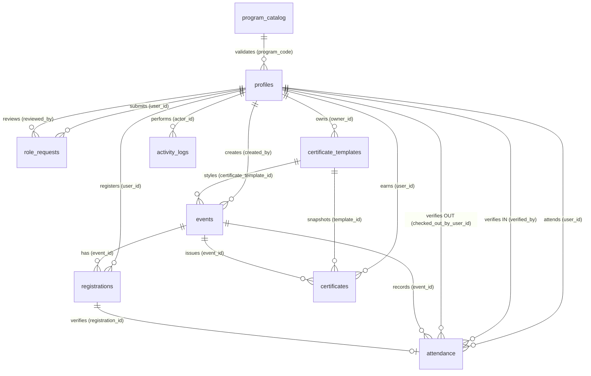

# EventSync: A Distributed Event Registration and Attendance Management System

**Final Project Documentation for Parallel and Distributed Computing**

- **Submitted to:** Mr. Bruce Casiano
- **Submitted by:**
  - Arrogante, Angeline D.
  - Coma, Apple M.
  - Estovio, Richard Jr.
  - Juntilla, Kevin Guiller S.
  - Mondelo, Carmela C.
  - Ramos, Jovans Jay A.
- **Course / Section:** BSCS-4B
- **Date Submitted:** November 2026

---

## PART II. SYSTEM DOCUMENTATION

### 2.1 System Overview

EventSync is a web-based distributed event registration and attendance management system designed to simplify the organization, monitoring, and documentation of school events, seminars, workshops, and other institutional activities at Biliran Province State University (BiPSU) Main Campus. The system supports three user roles—**Participant**, **Event Organizer**, and **Administrator**—and provides a unified platform for event publication, eligibility-checked online registration, digital QR pass and short-code issuance, Time-In and Time-Out attendance verification, real-time monitoring, post-event feedback, and verified attendance certificates.

Every new account starts as a **Participant** (student, faculty, or staff). Participants who wish to host events can submit an **Event Organizer** role request from their profile, which becomes active once reviewed and approved by an Administrator. Approved Event Organizers retain their participant capabilities for other organizers' events while gaining access to an **Organizer View** to create and manage their own events, scan attendance, monitor live arrivals, configure certificate templates, and export official reports. Administrators oversee all events, manage user accounts and role requests, and monitor system-wide activity logs.

EventSync utilizes HTML5, CSS3, and modular ES6 JavaScript for its frontend interface, while Supabase provides PostgreSQL database management, Row-Level Security (RLS), authentication, private/public file storage, and real-time data synchronization. The system implements a multi-tier client–server architecture in which four interconnected client nodes—accessed through laptops and cellphones—perform designated functions: **Admin / Organizer Management Node**, **Participant Node**, **QR Scanner Node**, and **Live Monitor Node**. Through a shared cloud-based database, transactional Remote Procedure Calls (RPCs), WebSocket-based real-time subscriptions, and an offline scan queue with automatic resynchronization, transactions performed on one device are coordinated and reflected across all other authorized devices.

### 2.2 Problem Statement

Traditional event registration and attendance monitoring in educational institutions often rely on manual registration forms, paper-based sign-in and sign-out sheets, and separate spreadsheets. These manual processes frequently result in long queues at venue entrances, duplicate or illegible entries, proxy sign-ins, difficulty tracking late arrivals or early departures, and significant delays in consolidating attendance reports and issuing certificates of participation. Event organizers and school administrators also face challenges monitoring live turnout across multiple entrance stations and verifying whether only eligible students from specific schools, programs, or year levels have registered.

EventSync addresses these challenges by providing a centralized distributed platform for online registration, QR code and 8-character pass code attendance verification (supporting both Time-In and Time-Out), automatic late-arrival labeling, real-time multi-device monitoring, print-ready attendance sheets, post-event feedback distribution, and automated certificate issuance with public QR verification.

### 2.3 General Objectives

The general objective of EventSync is to develop a distributed event registration and attendance management system that enables multiple interconnected devices to communicate, exchange information, and coordinate operations in real time while ensuring accurate attendance tracking, role-based access control, and reliable institutional reporting at BiPSU Main Campus.

### 2.4 Specific Objectives

Specifically, the system aims to:

1. Develop a role-based platform supporting **Participants**, **Event Organizers** (via an admin-approved role request workflow), and **Administrators** for creating, managing, and publishing institutional events with optional school, program, and year-level eligibility restrictions.
2. Implement online participant registration with unique QR code passes and 8-character alphanumeric verification codes, validated against the official BiPSU Main Campus program catalog.
3. Enable real-time data synchronization among interconnected laptops and cellphones using Supabase Realtime (WebSocket `postgres_changes` subscriptions).
4. Provide QR code and manual short-code attendance verification with **Time-In** and **Time-Out** modes, full-screen scan outcome modals, configurable late-arrival labeling (`Present (Late)`), self-scan prevention, duplicate prevention, and an offline scan queue that automatically synchronizes when internet connectivity is restored.
5. Generate automated attendance sheets and reports in Excel (`.xlsx`), CSV, PDF, and clean A4 landscape print formats, along with post-event Google Form feedback links and downloadable **Certificates of Participation** verified through a public verification page (`/verify/<certificate_code>`).

### 2.5 Scope and Limitations

#### Scope
EventSync is designed for managing school events, seminars, workshops, and institutional activities at Biliran Province State University (BiPSU) Main Campus. The system covers:
- **Three user roles:** Participants (students, faculty, and staff), Event Organizers (approved via role requests and scoped to their own events), and Administrators (system-wide oversight).
- **Institutional profile management:** Validated against the official BiPSU Main Campus schools, academic programs, majors, year levels, sections, and administrative offices.
- **Event management & eligibility rules:** Event schedules, registration windows, check-in grace periods, late-arrival thresholds, capacity limits, event banners, and optional restrictions by school/office, program, and year level.
- **Attendance verification:** Camera-based QR scanning and 8-character short-code manual verification supporting **Time-In** and **Time-Out** modes, full-screen visual/audio feedback modals, and an offline scan queue with idempotent resynchronization.
- **Post-event features:** Automated **Attendance Sheet** generation (Excel, CSV, PDF, and A4 landscape printout with school/office breakdown), Google Form feedback gating (*People who attended* or *Everyone who registered*, plus early-open support), and custom-designed **Certificates of Participation** with one-click name placement and public verification (`/verify/<certificate_code>`).

#### Limitations
- EventSync requires an internet connection for account authentication, online event registration, real-time monitor updates, and certificate downloads. While the QR Scanner Node supports queuing scans locally during temporary network drops and syncing them upon reconnection, new user sign-ups and initial event registrations require active connectivity.
- Camera-based QR code scanning requires a device with a working camera and a secure browser context (`HTTPS` or `localhost`); devices without camera access can use the 8-character short pass code for manual verification.
- Post-event feedback uses external Google Forms links configured by the organizer; EventSync controls visibility of the link based on event completion and attendance status but does not read individual Google Form responses.
- The system is tailored for BiPSU Main Campus institutional events and does not include payment processing or paid ticket sales.

### 2.6 System Features and Functionalities

| Feature | Description |
| :--- | :--- |
| **1. Role-Based Access & Organizer Role Requests** | Every new account registers as a **Participant**. Participants can submit an **Event Organizer** request from their profile; Administrators review, approve, or reject requests from the Users page. Approved Organizers get a **Participant View ↔ Organizer View** switch to manage their own events while still attending other organizers' events. |
| **2. Event Management & Eligibility Restrictions** | Organizers and Administrators can create, edit, publish, unpublish, and cancel events with banner images, capacities, registration windows, check-in grace windows, *"Mark as late after (min)"* thresholds, and optional eligibility restrictions by **School/Office**, **Program**, and **Year Level**. |
| **3. Online Registration & Digital QR / Short-Code Pass** | Eligible participants can browse published events, view live remaining seat counts, and register online. Each registration generates a downloadable PNG **EventSync Pass** containing a unique QR code (`EVENTSYNC:<uuid>`) and a copyable **8-character short pass code** (e.g., `A3E39F4A`). |
| **4. Time-In / Time-Out QR Scanner & Full-Screen Modal** | Scanner stations feature a **`[ Time In ]` / `[ Time Out ]`** mode switch, live camera QR decoding, and manual 8-character code verification. Every scan opens an arm's-length **full-screen outcome modal** (*CHECKED IN*, *CHECKED OUT*, *ALREADY CHECKED IN*, *ALREADY CHECKED OUT*, *NO TIME-IN RECORDED*, *NOT OPEN YET*, *ATTENDANCE CLOSED*, *WRONG EVENT*, *SELF-SCAN BLOCKED*, *SAVED OFFLINE*, or *INVALID QR*) with distinct audio and vibration feedback. |
| **5. Offline Scan Queue & Idempotent Resync** | If a scanner device loses internet connectivity during an event, scans are saved locally in an **Offline Queue** with their exact scan timestamp and unique `scan_id`. When connectivity returns, `sync_offline_attendance` replays queued scans in chronological order without creating duplicates. |
| **6. Late Attendance Labeling (`Present (Late)`)** | Computes whether a participant's Time-In occurred more than $N$ minutes after the event start time (using the actual scan timestamp, including for offline-synced scans). Late arrivals are labeled **`Present (Late)`** across the attendance sheet, Live Monitor, exports, and participant views while still counting toward total present attendance. |
| **7. Real-Time Attendance Monitor** | Displays live registration totals, verified check-in counts, remaining pending attendees, attendance rate percentage, a real-time arrival/departure feed, and activity logs across all connected devices via Supabase Realtime. |
| **8. Automated Reports & Clean A4 Print Sheet** | Generates official attendance sheets with *Time In*, *Time Out*, *Present / Present (Late) / Absent / Pending* statuses, summary totals (*Total Registered, Total Present, Total Late, Total Timed Out, Total Absent, Attendance Rate*), and an *Attendance by School / Office* breakdown. Supports Excel (`.xlsx`), CSV, PDF, and clean headerless A4 landscape printing. |
| **9. Post-Event Google Form Feedback** | Organizers can attach a validated Google Forms URL to an event, choose who can answer (*People who attended* or *Everyone who registered*), or open feedback early. Eligible participants see a **Give feedback** button and notification banner once feedback is open. |
| **10. Custom Attendance Certificates & Public Verification** | Organizers and Admins can upload custom certificate designs (PNG, JPG, or single-page PDF) and position the participant's name with a one-click live preview editor, or use the built-in BiPSU default template. Attended participants can download their **Certificate of Participation** (PDF/PNG) after the event ends. Each certificate carries a random non-sequential code (`CERT-2026-XXXXXXXX`) and QR code verifiable at `/verify/<certificate_code>`. |

---

## PART III. SYSTEM ARCHITECTURE DIAGRAM

### 3.1 System Architecture


> **Figure 1. EventSync Multi-Tier Client–Server Architecture**
> *(Insert the labeled Multi-Tier Client–Server Architecture diagram showing the Presentation Layer [Admin/Organizer Node, Participant Node, QR Scanner Node, Live Monitor Node], Application Layer [Supabase Auth, PostgREST / Transactional RPCs, Realtime WebSockets, Edge Functions], and Backend & Database Layer [PostgreSQL Database, Storage Buckets, Row-Level Security].)*

### 3.2 Participating Computers and Assigned Roles

| Computer / Device | Assigned Role | Responsibilities |
| :--- | :--- | :--- |
| **Supabase Cloud Backend (Central Host)** | **Cloud Server & Database Host** | Hosts the centralized PostgreSQL database, enforces Row-Level Security (RLS) and unique constraints, executes transactional RPCs (`register_for_event`, `verify_attendance`, `sync_offline_attendance`, `attendance_sheet`, `issue_my_certificate`, `verify_certificate_code`), stores event banners and certificate templates in Supabase Storage, and broadcasts live state changes via Supabase Realtime WebSockets. |
| **Computer 1 (Laptop)** | **Admin / Event Organizer Node** | Used by Administrators and approved Event Organizers to create, edit, and publish events, configure eligibility rules, upload custom certificate designs, link post-event feedback forms, review organizer role requests, manage user accounts, and export/print official attendance sheets. |
| **Computer 2 (Laptop or Cellphone)** | **Participant Node** | Used by students, faculty, and staff to sign up, complete their BiPSU academic/office profile, browse published events, register online, view/download their QR pass and 8-character code, request the Event Organizer role, answer post-event feedback forms, and download their Certificate of Participation. |
| **Computer 3 (Cellphone or Laptop with Camera)** | **QR Scanner Node** | Positioned at venue entrances/exits to scan participant QR passes (or verify 8-character short codes) in **Time In** or **Time Out** mode, display full-screen outcome modals, queue scans offline during temporary Wi-Fi drops, and resynchronize queued scans upon reconnection. |
| **Computer 4 (Laptop / Shared Display)** | **Live Monitor Node** | Displays real-time registration counts, verified attendance totals, attendance rate percentage, and a live arrival/check-out feed (`Present`, `Present (Late)`, `Timed Out`) as transactions occur across all connected devices. |

### 3.3 Communication Methods

| Communication Detail | Description / Specification |
| :--- | :--- |
| **Communication Protocol** | **HTTPS (TLS)** for REST API calls, authentication, storage uploads, and transactional RPC execution; **WSS (Secure WebSocket)** for Supabase Realtime publish–subscribe change notifications. |
| **Communication Technology** | Wireless LAN (**Wi-Fi**) and Mobile Data (**4G/5G**) connecting client laptops and cellphones to the Vercel frontend host and Supabase cloud backend. |
| **Network Connection** | Distributed client nodes connect over the internet to the deployed Vercel web application (`https://eventsync-lake.vercel.app`) and communicate directly with the centralized Supabase cloud cluster. |
| **Data Exchange Method** | **JSON payloads** exchanged over PostgREST HTTP endpoints and PostgreSQL `SECURITY DEFINER` RPC functions, paired with asynchronous WebSocket event streams (`postgres_changes` on `events`, `registrations`, `attendance`, `profiles`, `role_requests`, and `certificates`). |

---

## PART IV. NETWORK COMMUNICATION DIAGRAM

### 4.1 Network Communication Flow


> **Figure 2. EventSync Network Communication Diagram**
> *(Insert the Network Communication Diagram illustrating HTTPS Request/Response arrows and WSS Realtime Data Update arrows between the four client nodes [Admin/Organizer Node, Participant Node, QR Scanner Node, Live Monitor Node] and the Supabase Cloud Backend.)*

### 4.2 Explanation of Network Communication

1. **How does a client computer send a request?**
   Each client device runs the EventSync web application in a browser and sends authenticated **HTTPS requests** (carrying the user's Supabase Auth JWT in the `Authorization: Bearer <token>` header) to the Supabase REST API or RPC endpoint. For example, clicking **Register** on the Participant Node invokes `supabase.rpc('register_for_event', { p_event_id })`, and scanning a QR code on the QR Scanner Node invokes `supabase.rpc('verify_attendance', { p_qr_token, p_event_id, p_mode, p_direction })`.

2. **Which computer receives and processes the request?**
   The centralized **Supabase Cloud Backend** (PostgREST API gateway and PostgreSQL database server) receives the HTTPS request, verifies the caller's JWT session and role permissions (`is_admin()`, `is_organizer()`, `can_manage_event()`), and executes the corresponding transactional function.

3. **How is information retrieved from or stored in the database?**
   Inside PostgreSQL, `SECURITY DEFINER` RPC functions execute atomic transactions with row-level locks (`SELECT ... FOR UPDATE`) and unique constraints. When registering, `_register_core` locks the event row, checks schedule windows, capacity, and school/program/year eligibility, and inserts a row into `public.registrations`. When scanning, `_record_attendance` validates the QR token, blocks self-scans, checks the attendance window, and atomically inserts or updates `public.attendance` (for `IN` or `OUT` mode) while recording an audit entry in `public.activity_logs`.

4. **How is the response transmitted back to the requesting computer?**
   PostgreSQL returns a structured **JSON object** (such as `{ status: "ok", code: "OK", mode: "IN", participant: "...", checked_in_at: "..." }`) through PostgREST over HTTPS to the requesting client browser, which immediately updates its UI (for example, opening the full-screen green **CHECKED IN** modal on the QR Scanner Node).

5. **How do the other participating computers interact with the system?**
   All connected nodes maintain an active **Secure WebSocket (WSS)** subscription to Supabase Realtime (`watch([...tables])`). Whenever a transaction commits on `events`, `registrations`, `attendance`, `profiles`, `role_requests`, or `certificates`, PostgreSQL's Write-Ahead Log (WAL) broadcasts the change event over WSS to all subscribed nodes. The Live Monitor Node, Admin/Organizer Node, and Participant Node automatically re-fetch and re-render their counters, feeds, feedback buttons, and certificate statuses in real time without manual page refreshes. If a QR Scanner Node temporarily loses internet access, it stores scans locally in `localStorage` (`eventsync_scan_queue`) and automatically invokes `sync_offline_attendance` when the browser detects network restoration (`online` event).

---

## PART V. DATABASE DESIGN

### 5.1 Entity Relationship Diagram (ERD)



> **Figure 3. Entity Relationship Diagram (ERD)**
> *(The database consists of 9 interconnected tables linking user profiles, the BiPSU program catalog, organizer role requests, events, registrations, attendance check-ins/outs, certificate templates, issued certificates, and activity logs.)*

### 5.2 Database Description

| Database Detail | Description / Specification |
| :--- | :--- |
| **Database Name** | `postgres` (EventSync Production Schema `public`) |
| **Database Management System (DBMS)** | **PostgreSQL 15+** (Managed via Supabase) |
| **Database Location** | Cloud-hosted (Supabase AWS Asia-Pacific Northeast Region) |
| **Database Type** | **Relational Database (RDBMS)** with Row-Level Security (RLS), JSONB support, and real-time WAL replication |
| **Connection Method** | Browser clients connect via `@supabase/supabase-js` over HTTPS (PostgREST) and WSS (Supabase Realtime); administrative/test scripts connect via pooled PostgreSQL TLS connection (`pg`). |

### 5.3 Database Tables

| Table Name | Purpose / Description |
| :--- | :--- |
| **`profiles`** | Stores user accounts linked to `auth.users(id)`, including `full_name`, `email`, `role` (`'user'`, `'organizer'`, `'admin'`), `school_id` (unique), `contact_number`, `member_type` (`'student'`, `'faculty'`, `'staff'`), `department` (school/office), `program`, `major`, `program_code` (FK), `year_level`, `section`, `status` (`'active'`, `'inactive'`), and `must_change_password`. |
| **`program_catalog`** | Stores the official BiPSU Main Campus academic catalog (`program_code` PK, `school_code`, `school_name`, `program_name`, `short_name`, and `majors` array) used to validate participant profiles. |
| **`role_requests`** | Tracks participant requests to become an Event Organizer (`id` PK, `user_id` FK, `reason`, `planned_events`, `status` [`'pending'`, `'approved'`, `'rejected'`], `reviewed_by` FK, `decision_reason`, `created_at`, `reviewed_at`). Enforces at most one pending request per user. |
| **`events`** | Stores event records (`id` PK, `title`, `description`, `venue`, `starts_at`, `ends_at`, `registration_opens_at`, `registration_deadline`, `early_grace_minutes`, `late_grace_minutes`, `late_after_minutes`, `capacity`, `registered_count`, `status`, `image_path`, `feedback_url`, `feedback_audience`, `feedback_opened_early`, `allowed_schools`, `allowed_programs`, `allowed_year_levels`, `certificates_enabled`, `certificate_template_id` FK, `created_by` FK). |
| **`registrations`** | Records participant event registrations (`id` PK, `event_id` FK, `user_id` FK, `status` [`'registered'`, `'cancelled'`], unique `qr_token` UUID, `registered_at`) with a composite unique constraint on `(event_id, user_id)`. |
| **`attendance`** | Stores verified attendance records (`id` PK, unique `registration_id` FK, `event_id` FK, `user_id` FK, `verified_by` FK, `checked_in_at`, `check_in_scan_id` unique, `check_out_time`, `check_out_scan_id` unique, `checked_out_by_user_id` FK, `is_test`, `clock_suspect`, `voided`, `void_reason`). |
| **`certificate_templates`** | Stores reusable certificate designs (`id` PK, `owner_id` FK, `name`, `file_path` in private storage, `mime_type`, `width`, `height`, `layout` JSONB array of field positions, `version`, `is_global`, `is_active`, `created_at`, `updated_at`). |
| **`certificates`** | Stores issued participant certificates (`id` PK, unique non-sequential `certificate_code` e.g. `CERT-2026-K7M4Q9X2`, `user_id` FK, `event_id` FK, `template_id` FK, `template_version`, frozen `layout_snapshot` JSONB, `name_at_issuance`, `event_name_at_issuance`, `event_date_at_issuance`, `status` [`'valid'`, `'revoked'`], `revoked_by`, `revoked_at`, `revoke_reason`) with a unique constraint on `(user_id, event_id)`. |
| **`activity_logs`** | Maintains an audit trail of system transactions (`id` PK, `actor_id` FK, `action`, `entity`, `entity_id`, `details` JSONB, `created_at`) covering event updates, registrations, check-ins, check-outs, role request decisions, report exports, and certificate issuance/revocation. |

---

## PART VI. SOURCE CODE

### 6.1 Source Code Description

| Technology | Name / Version | Purpose |
| :--- | :--- | :--- |
| **Programming Languages** | HTML5, CSS3, JavaScript (ES2022 Modules), SQL (PL/pgSQL) | Frontend user interfaces, responsive dark + crimson theme, print stylesheet (`@media print`), client-side logic, and server-side database functions/triggers. |
| **Backend & Database Platform** | Supabase (`@supabase/supabase-js` v2.119.0, PostgreSQL 15) | Authentication, PostgreSQL database, Row-Level Security (RLS), transactional RPCs, Realtime WebSockets, Edge Functions, and Storage buckets (`event-images`, `certificate-templates`). |
| **Libraries & Utilities** | `html5-qrcode` v2.3.8, `qrcode` v1.5.3, `exceljs` v4.4.0, `jspdf` v2.5.1, `pdf-lib` v1.17.1 | Camera QR code scanning, QR pass & verification QR generation, Excel (`.xlsx`) workbook export, attendance report PDF generation, and custom certificate PDF generation. |
| **Development & Testing Tools** | Node.js v22 (`node:test`), `pg` v8.23.1, `serve` v14.2.3, Git / GitHub, Vercel | Local development server, automated build config generator, 60-test automated integration suite, version control, and cloud deployment. |

### 6.2 Source Code Repository / Files

| Item | Details |
| :--- | :--- |
| **Repository Link** | `https://github.com/angelicaarrogant3/EventSync` |
| **Deployed Application URL** | `https://eventsync-lake.vercel.app/` |
| **Source Code Folder Structure** | `admin/` (Admin & Organizer pages), `user/` (Participant portal pages), `verify.html` (Public certificate verification), `js/core/` (Supabase client, route guard, Realtime helper), `js/admin/` (events, registrations, scanner, full-screen modal, monitor, reports, users), `js/user/` (events, registrations, profile, QR pass modal), `js/shared/` (certificate engine & one-click editor, attendance sheet generator, BiPSU program selector, image uploader, validators), `config/` (BiPSU program catalog, schedule & late-checkin calculations, feedback URL validator), `supabase/migrations/` (SQL migrations `001`–`017`), `supabase/functions/` (Edge Functions), and `tests/` (automated test suite). |
| **Additional Setup Files** | `package.json`, `vercel.json`, `serve.json`, `tools/generate-config.js`, `tools/dev-server.js`, `tools/create-admin.js`. |

---

## PART VII. USER MANUAL

### 7.1 System Requirements

| Requirement | Specification |
| :--- | :--- |
| **Operating System** | Windows 10/11, macOS, Linux, Android 10+, or iOS 15+ |
| **Processor** | Dual-core 1.6 GHz or higher (any modern laptop, desktop, or smartphone processor) |
| **RAM** | At least 4 GB RAM (2 GB minimum on mobile devices) |
| **Network Requirements** | Wi-Fi or 4G/5G internet connection supporting HTTPS (port 443) and WebSocket (WSS) connections |
| **Required Software** | Updated web browser (Google Chrome 110+, Microsoft Edge 110+, Safari 15+, or Mozilla Firefox 110+) with camera permission enabled on QR Scanner devices |

### 7.2 Installation Guide

EventSync is deployed on Vercel and can be accessed immediately at `https://eventsync-lake.vercel.app/`. To install and run the system locally on the participating computers for development or testing:

1. **Install Node.js:** Download and install Node.js (v18 or v22 LTS) from `https://nodejs.org/`.
2. **Clone the Repository:** Open a terminal and run:
   ```bash
   git clone https://github.com/angelicaarrogant3/EventSync.git
   cd EventSync
   ```
3. **Install Dependencies:** Run the following command in the project root folder:
   ```bash
   npm install
   ```
4. **Apply Database Migrations:** Execute the SQL migration scripts in `supabase/migrations/` (`001_init.sql` through `017_attendance_certificates.sql`) in the Supabase SQL Editor.
5. **Start the Local Server:** Run `npm start` to launch the local web server at `http://localhost:8080`.
6. **Open Across Participating Devices:** On each participating laptop or cellphone, open the deployed URL (`https://eventsync-lake.vercel.app/`) or local server address in Google Chrome or Microsoft Edge.

### 7.3 System Configuration

1. **Supabase Connection Configuration (`js/config.js`):**
   Configure the Supabase project URL and anonymous public key in `js/config.js` (or set `SUPABASE_URL` and `SUPABASE_ANON_KEY` environment variables on Vercel, which `node tools/generate-config.js` writes during build):
   ```javascript
   export const SUPABASE_URL = 'https://<your-project-ref>.supabase.co';
   export const SUPABASE_ANON_KEY = '<your-anon-public-key>';
   ```
2. **Initial Administrator Setup:**
   Create or promote an administrator account using `npm run create-admin` (or via the Users management screen).
3. **Assigning Roles to Participating Devices:**
   - **Computer 1 (Admin / Organizer Node):** Sign in with an Administrator or approved Event Organizer account and open `/admin/events`.
   - **Computer 2 (Participant Node):** Sign in with a Participant account (or create a new account at `/login`) and open `/user/events`.
   - **Computer 3 (QR Scanner Node):** Sign in with an Admin or Event Organizer account, open `/admin/scan`, select the active event (or leave on *Auto-detect from QR*), choose **Time In** or **Time Out** mode, and grant browser camera permission.
   - **Computer 4 (Live Monitor Node):** Sign in with an Admin or Event Organizer account, open `/admin/monitor`, and select the event to display on the shared screen.

### 7.4 System Usage Instructions

#### Figure 4. Public Landing Page & Authentication (`/`, `/login`)
| *[Insert screenshot of the Landing Page and Login / Sign-Up screen here]* |
| :--- |
| **Description:** Visitors view plain-language instructions and upcoming published events on the landing page. Clicking **Sign Up** allows students, faculty, and staff to create a Participant account by selecting their member type (*Student*, *Faculty*, or *Staff*), School/College, BiPSU Program, Major (where applicable), Year Level, and School ID. |

#### Figure 5. Participant Event Browsing, Registration & QR Pass (`/user/events`, `/user/registrations`)
| *[Insert screenshot of Browse Events and the EventSync QR Pass Modal with 8-character short code here]* |
| :--- |
| **Description:** Participants browse published events, see any eligibility rules (*Open to: ...*) and live seat availability, and click **Register**. Clicking **View QR** opens their personal **EventSync Pass** showing the QR code, a one-tap copyable **8-character pass code** (e.g., `7AD9AD25`), and a **Download PNG** button. |

#### Figure 6. Requesting the Event Organizer Role & Admin Approval (`/user/profile`, `/admin/users`)
| *[Insert screenshot of the Event Organizer Role Request card on My Profile and the Organizer Role Requests queue on Admin Users here]* |
| :--- |
| **Description:** On **My Profile**, a participant can fill in why they need organizer access and what events they plan to run, then click **Become an organizer**. On **Admin → Users**, the Administrator sees the pending request under **Organizer Role Requests** and clicks **Approve** or **Reject**. Once approved, the user sees an **Organizer View ↔ Participant View** switch in the top bar. |

#### Figure 7. Event Creation, Eligibility Rules, Feedback & One-Click Certificate Design (`/admin/events`)
| *[Insert screenshot of the Create/Edit Event modal and the Upload Certificate Design modal here]* |
| :--- |
| **Description:** Organizers and Administrators create or edit events with schedule windows, grace minutes, *"Mark as late after (min)"*, optional **Eligibility restrictions** (School/Office, Program, Year Levels), a **Google Form feedback link** (*People who attended* or *Everyone who registered*, plus *Open feedback now*), and **Attendance Certificates**. Clicking **+ Upload / Design** or **Edit template** lets the organizer upload a ready-made certificate image (with only the Participant's Name left blank) and click directly on the name line to position the participant's name while automatically placing the verification QR and Certificate ID in the chosen corner. |

#### Figure 8. QR Scanner Station with Time-In / Time-Out & Full-Screen Outcome Modal (`/admin/scan`)
| *[Insert screenshot of the Scan QR page with Time In / Time Out switch and the full-screen CHECKED IN / CHECKED OUT modal here]* |
| :--- |
| **Description:** Staff at the entrance select **Time In** (green) or **Time Out** (blue) at the top of `/admin/scan`, then scan a participant's QR code with the camera or enter their 8-character short code manually. Every scan opens an instant **full-screen outcome modal** readable from arm's length (*CHECKED IN*, *CHECKED OUT*, *ALREADY CHECKED IN*, *NO TIME-IN RECORDED*, etc.) with sound and vibration feedback. If Wi-Fi drops, scans are saved in the **Offline Queue** and synced automatically upon reconnection. |

#### Figure 9. Live Attendance Monitor & Clean A4 Printable Reports (`/admin/monitor`, `/admin/reports`)
| *[Insert screenshot of the Live Attendance Monitor and the printed Event Attendance Sheet here]* |
| :--- |
| **Description:** The **Live Attendance Monitor** displays real-time registered counts, verified attendance, remaining attendees, attendance rate, and a live arrival/departure feed across devices. The **Reports** page exports the official **Event Attendance Sheet** (showing *Time In*, *Time Out*, *Present / Present (Late) / Absent / Pending*, summary totals including *Total Late* and *Total Timed Out*, and *Attendance by School / Office*) to Excel (`.xlsx`), CSV, PDF, or a clean A4 landscape printout. |

#### Figure 10. Post-Event Feedback, Certificate Download & Public Verification (`/user/profile`, `/verify/<code >`)
| *[Insert screenshot of the Participant Certificate Download modal and the Public Certificate Verification page here]* |
| :--- |
| **Description:** After an event ends, attended participants see **Certificate ready** and **Download certificate** (PDF / PNG) alongside **Give feedback** on **My Registrations** and **My Profile**. Scanning the QR code on any issued certificate opens `/verify/<certificate_code>`, displaying whether the certificate is **VALID**, **REVOKED**, or **NOT FOUND** along with the participant name, event name, event date, and issuing organizer. |

---

## PART VIII. TESTING DOCUMENTATION

### 8.1 Testing Overview

EventSync was tested through both multi-device distributed testing across interconnected laptops and smartphones and a 60-test automated integration suite (`npm test`) executed against the live Supabase PostgreSQL, Auth, Storage, and Realtime backend. Testing verified client connectivity, role-based access control, eligibility enforcement, concurrent registration and scan conflict handling, Time-In and Time-Out state transitions, late-arrival computation, offline scan queuing and idempotent resynchronization, post-event feedback gating, custom certificate issuance and verification, and real-time multi-node synchronization.

### 8.2 Testing Environment

| Computer / Device | Assigned Role | Operating System | Network Connection |
| :--- | :--- | :--- | :--- |
| **Computer 1 (Laptop 1)** | **Admin / Organizer Node** | Windows 11 (64-bit), Chrome 130 | Wi-Fi / Internet (HTTPS & WSS to Supabase Cloud) |
| **Computer 2 (Laptop 2 / Smartphone 1)** | **Participant Node** | Windows 11 / Android 14, Chrome 130 | Wi-Fi / Mobile Data (HTTPS & WSS to Supabase Cloud) |
| **Computer 3 (Smartphone 2 / Laptop 3)** | **QR Scanner Node** | Android 14 / Windows 11, Chrome 130 | Wi-Fi / Mobile Data (with simulated offline drop & reconnect) |
| **Computer 4 (Laptop 4)** | **Live Monitor Node** | Windows 11 (64-bit), Microsoft Edge 130 | Wi-Fi / Internet (HTTPS & WSS to Supabase Cloud) |

### 8.3 Test Cases and Results

| Test Case | Expected Result | Actual Result | Status |
| :--- | :--- | :--- | :--- |
| **1. Client Connection & Role Routing** | Authenticated users connect to Supabase and are routed to `/user/events` (Participant) or `/admin/events` (Organizer/Admin); deactivated users are blocked at login. | Clients connected over HTTPS/WSS; role guards and account deactivation locks worked as expected. | **Pass** |
| **2. BiPSU Profile Validation & Security** | Sign-up validates School/College, Program, Major, Year Level (students), Contact Number, and unique School ID/Email; public sign-up can never self-assign `admin` or `organizer`. | All valid profiles saved with foreign key `program_code`; duplicate IDs/emails and role-escalation attempts were rejected. | **Pass** |
| **3. Organizer Role Request & Approval Flow** | A participant submits an organizer request (`pending`); duplicate pending requests and admin self-approvals are blocked; admin approval promotes the user to `organizer` and logs the decision. | Request created and approved via `admin_review_role_request`; user role updated to `organizer` with `Participant View ↔ Organizer View` switch. | **Pass** |
| **4. Event Eligibility & Host Registration Rules** | Events restricted by School, Program, or Year Level reject ineligible participants; organizers cannot register as attendees for their own hosted events. | Ineligible registrations and organizer self-registrations were blocked both in the UI and by `_register_core`. | **Pass** |
| **5. Concurrent Registration & Capacity Enforcement** | Multiple participants registering simultaneously for the last remaining seat never exceed event capacity or create duplicate registrations. | Row-level locking (`FOR UPDATE`) and `UNIQUE (event_id, user_id)` allowed exactly the capacity limit and rejected overflow requests with `"Event is full"`. | **Pass** |
| **6. QR & 8-Character Pass Code Time-In / Time-Out** | Scanner records Time-In (`CHECKED IN`) and Time-Out (`CHECKED OUT`), rejects Time-Out before Time-In (`NO TIME-IN RECORDED`), blocks duplicate scans, and blocks self-scans (`SELF_SCAN_NOT_ALLOWED`). | Full-screen modal displayed the exact outcome for every camera QR and 8-character manual code verification; self-scans and duplicates were blocked. | **Pass** |
| **7. Attendance Windows & Late Labeling (`Present (Late)`)** | Scans before `opens_at` or after `closes_at` are rejected; check-ins more than $N$ minutes after `starts_at` are labeled `Present (Late)` while counting toward Total Present. | Boundary timestamps (`on time`, `exact limit`, `late`, `disabled`) and report totals (`Total Late`) matched expected values. | **Pass** |
| **8. Offline Scan Queue & Idempotent Resync** | Scans performed while offline are queued locally (`SAVED OFFLINE`) and synced chronologically upon reconnection without duplicates on retry. | `sync_offline_attendance` replayed queued Time-In and Time-Out scans in timestamp order and ignored duplicate `scan_id` replays. | **Pass** |
| **9. Real-Time Multi-Computer Synchronization** | Registrations and scans on one device immediately update the Live Monitor Node, Admin Node, and Participant Node via Supabase Realtime without page refresh. | WebSocket `postgres_changes` events updated all connected nodes within ~1 second. | **Pass** |
| **10. Post-Event Google Form Feedback Gating** | Only valid `https://` Google Forms URLs are accepted; `feedback_url` is hidden from direct table `SELECT` by participants and shown only when the event ends (or opens early) to the eligible audience. | Non-Google URLs and direct column reads were blocked; eligible participants saw the **Give feedback** button and banner at the exact end/early-open state. | **Pass** |
| **11. Attendance Certificates & Public Verification** | Attended participants can download their PDF/PNG certificate after the event ends; template edits do not alter already-issued certificates; `/verify/<code>` shows `valid`, `revoked`, or `not_found` without exposing PII. | `issue_my_certificate` generated unique `CERT-2026-XXXXXXXX` certificates with frozen `layout_snapshot`; `/verify/<code>` and revocation/reissue passed all checks. | **Pass** |
| **12. Attendance Sheet Exports & Clean A4 Print** | Reports export accurately to Excel (`.xlsx`), CSV, PDF, and clean A4 landscape print format with no browser navbar/chrome and a School/Office breakdown. | All export formats and `@media print` rules rendered only the official attendance sheet and summary tables. | **Pass** |

### 8.4 Testing Evidence

#### Testing Evidence 1 – Admin / Organizer Computer
| *[Insert genuine screenshot or photograph of the Admin/Organizer Node managing events, reviewing organizer role requests, and viewing reports]* |
| :--- |
| **Caption:** Computer 1 (Admin / Organizer Node) creating an event, configuring certificate template placement, and viewing live attendance reports. |

#### Testing Evidence 2 – Participant & QR Scanner Client Devices
| *[Insert genuine screenshot or photograph of the Participant Node displaying the QR pass / 8-character code and the QR Scanner Node showing the full-screen CHECKED IN modal]* |
| :--- |
| **Caption:** Computer 2 (Participant Node) displaying an issued EventSync QR Pass and Computer 3 (QR Scanner Node) verifying Time-In and Time-Out attendance. |

#### Testing Evidence 3 – Live Monitor & Real-Time Data Communication
| *[Insert genuine screenshot or photograph of the Live Monitor Node updating in real time alongside the automated 60/60 passing test suite output]* |
| :--- |
| **Caption:** Computer 4 (Live Monitor Node) receiving instant WebSocket attendance updates from Supabase Realtime as scans are processed. |

### 8.5 Testing Summary

Across all manual multi-device demonstrations and **60 automated integration tests** (`60 passed, 0 failed`), EventSync performed all intended distributed functions reliably. All four client roles—Admin/Organizer Node, Participant Node, QR Scanner Node, and Live Monitor Node—communicated seamlessly through the centralized Supabase cloud backend over HTTPS and Secure WebSockets (WSS). Transactional RPCs and PostgreSQL constraints prevented race conditions, capacity overflows, self-scans, and duplicate check-ins/check-outs. Temporary network disconnections on the QR Scanner Node were handled gracefully by the local offline queue and idempotent resynchronization RPC.

---

## PART IX. FINAL PRESENTATION AND DEMONSTRATION

### 9.1 Presentation Overview

During the final project demonstration, the group presents EventSync running live across four interconnected devices connected to the deployed application (`https://eventsync-lake.vercel.app/`):

1. **Role Request & Event Setup (Computer 1 – Admin / Organizer Node):** Approving a participant's Event Organizer request, creating and publishing an event with eligibility rules, uploading a custom certificate design with one-click participant name placement, and attaching a post-event Google Form feedback link.
2. **Online Registration & Pass Issuance (Computer 2 – Participant Node):** Browsing published events, registering online, and generating the digital QR code pass with its 8-character short code.
3. **Time-In, Time-Out & Offline Fault Tolerance (Computer 3 – QR Scanner Node):** Scanning the participant's QR code in **Time In** and **Time Out** modes to trigger the full-screen outcome modal, demonstrating duplicate/self-scan prevention, and simulating an offline scan followed by automatic resynchronization.
4. **Live Synchronization, Reporting & Certificate Verification (Computer 4 – Live Monitor Node & Participant/Admin Views):** Observing real-time counter and arrival feed updates on the Live Monitor without refreshing, printing the clean A4 landscape Event Attendance Sheet, answering the post-event feedback form, downloading the participant's PDF Certificate of Participation, and verifying its QR code on `/verify/<certificate_code>`.

### 9.2 Presentation Evidence

#### Figure 11. Final Presentation and Demonstration
| *[Insert genuine photographs or screenshots of the group's final presentation and working 4-device demonstration here]* |
| :--- |

### 9.4 Conclusion

The development and deployment of **EventSync** successfully demonstrated how distributed computing principles can modernize institutional event registration and attendance management at Biliran Province State University (BiPSU) Main Campus. By combining a multi-tier client–server architecture with transactional PostgreSQL Remote Procedure Calls (RPCs), Row-Level Security (RLS), and WebSocket-based real-time synchronization via Supabase Realtime, the system enables multiple independent laptops and smartphones to coordinate event operations concurrently while maintaining strict data consistency.

Through features such as role-based organizer requests, program-catalog-validated profiles, event eligibility restrictions, full-screen Time-In and Time-Out QR verification, automatic late-arrival labeling, offline scan queuing with idempotent resynchronization, clean A4 attendance sheet printouts, post-event feedback gating, and custom-designed certificates with public QR verification, EventSync eliminates the bottlenecks and inaccuracies of manual paper-based workflows and provides a practical, scalable solution for university events.
