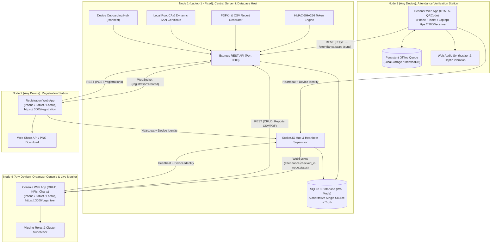

# EventSync: System Architecture & Design Justification

## 1. System Architecture Diagram

---

## 2. Architecture Justification: Multi-Tier Client-Server

The architecture chosen for EventSync is a **Multi-Tier Client-Server with Device-Agnostic Client Nodes and Central Database Authority**.

### Why Multi-Tier Client-Server instead of Peer-to-Peer (P2P)?
1. **Linearizable Capacity Invariant:** Event registration requires strict atomicity regarding seat capacity. If 4 devices independently registered participants without a central coordination authority, resolving race conditions for the 50th seat would require complex distributed consensus (Raft or Paxos). In a campus event scenario, a central database server provides deterministic serialization (ACID transactions) without consensus overhead.
2. **Specialized Role Separation:** University event workflows have natural division of labor (one desk registers, another gate scans, the organizer monitors). Role-dedicated client nodes map directly to physical campus workflows.

### Why Single-Origin LAN HTTPS with Flexible Device Support?
1. **Device Flexibility (1 Laptop + Any Devices):** Students frequently have only one laptop available on demo day, but can easily borrow smartphones or tablets. By serving all role applications directly from the central laptop over HTTPS:
   - Any device with a modern browser can immediately assume any role.
   - Devices do not need Node.js, Git, or developer tooling installed.
2. **Browser Security & Camera Constraints (`getUserMedia`):** Modern web browsers enforce strict security boundaries. The W3C Media Capture API only permits camera hardware access over `https://` or `localhost`. By generating a local Root CA and SAN server certificate covering the laptop's LAN IP, mobile phones and tablets gain full camera and service worker access over Wi-Fi.
3. **No CORS / Mixed Content Issues:** All API calls, WebSocket events, and static assets originate from `https://<LAPTOP_IP>:3000`, eliminating cross-origin security blocks.

---

## 3. Communication Protocols: REST vs. WebSockets

EventSync strategically couples two complementary network communication protocols:

### 1. REST over HTTP/1.1 (Synchronous Command-Query Execution)
- **Use Case:** State-modifying transactions and bulk data retrieval:
  - Event creation, updating, and status transitions (`POST /events`, `PATCH /status`)
  - Participant registration with atomic capacity enforcement (`POST /registrations`)
  - Verification requests (`POST /attendance/scan`, `POST /attendance/manual`)
  - Batch synchronization of offline queues (`POST /attendance/sync`)
  - Report downloads (`GET /events/:id/report?format=csv|pdf`)
- **Justification:** REST is stateless, standard, idempotently retryable, and returns clean HTTP status codes (`200 OK`, `201 Created`, `400 Bad Request`, `404 Not Found`, `409 Conflict`).

### 2. WebSockets via Socket.IO (Asynchronous Low-Latency Real-Time Push)
- **Use Case:** Near real-time state fan-out and distributed failure detection:
  - `registration:created`: Instantly decrements remaining capacity counters on Node 2 and increments registration tallies on Node 4.
  - `attendance:checked_in`: Streams check-in events directly into Node 4's live dashboard, updating KPIs and charts with sub-100ms latency.
  - `node:heartbeat` and `node:status`: Enables Node 1 to supervise cluster liveness and broadcast online/offline transitions, device types, and missing-role alerts.
- **Justification:** Eliminates polling overhead. Client nodes stay passive until the server pushes verified state updates.

---

## 4. Hardware & Role Deployment Matrix

| Node | Role | Hardware Requirements | What Runs There |
|---|---|---|---|
| **Node 1** | **Server & DB Host** | **1 Laptop (Fixed)** | Node.js Express REST API, Socket.IO hub, SQLite WAL host, Root CA certificate manager, QR token signer, PDF generator. |
| **Node 2** | **Registration Station** | Any Device (Phone, Tablet, or Laptop) | Responsive registration web app, remaining quota listener, signed QR pass preview, Web Share API pass distribution. |
| **Node 3** | **Verification Station** | Any Device (Phone, Tablet, or Laptop) | HTML5-QRCode webcam scanner, manual ID fallback, audio synthesizer, persistent offline queue (Store-and-Forward). |
| **Node 4** | **Organizer Console** | Any Device (Phone, Tablet, or Laptop) | Real-time monitoring dashboard, event CRUD modal, cluster health panel, missing-roles supervisor, CSV/PDF reports. |

---

## 5. Backward Compatibility (Original 4-Laptop Mode)

The system retains 100% backward compatibility with the original 4-laptop multi-port architecture:
- `npm run start:server` runs Node 1 on port 3000.
- `npm run start:registration` runs Node 2 standalone static server on port 3001.
- `npm run start:scanner` runs Node 3 standalone static server on port 3002.
- `npm run start:organizer` runs Node 4 standalone static server on port 3003.
- `npm run start:all` launches all four processes concurrently for single-laptop development.

---

## 6. Authentication, Sessions & Role-Based Access Control (RBAC)

> **Device Policy Note:** This group has the instructor's explicit permission to use smartphones as client devices alongside the single host laptop (`Node 1`).

### 6.1 Authentication & Session Architecture
- **Password Hashing:** `bcryptjs` (cost factor 10). Passwords must be at least 8 characters.
- **Server-Side Sessions:** Stored in SQLite `sessions` table and delivered via an `httpOnly`, `SameSite=Lax` cookie (`eventsync_sid`). `Secure` is set when running in HTTPS mode. Sessions expire after inactivity (default 120 minutes, configurable via `SESSION_TIMEOUT_MINUTES`).
- **Socket.IO Authentication:** Every WebSocket/polling handshake validates the `eventsync_sid` cookie via `io.use(...)`. Unauthenticated sockets are rejected (`UNAUTHORIZED`). Administrator sockets join `role:administrator` (receiving cluster health, registration, and check-in broadcasts); Participant sockets join `role:participant` and `user:<id>` (receiving only public event availability updates and their own registration/attendance updates).

### 6.2 Role-Protected Routes
- **Public:** `/login`, `/signup`, `/connect`, `/api/health`, `/api/connect-info`, `/api/auth/login`, `/api/auth/signup`, `/api/auth/logout`.
- **Participant (`role = 'participant'`):** `/app`, `/app/events`, `/app/events/:id`, `/app/my-events`, `/app/my-qr`, `/app/my-attendance`, `/app/profile`, `/api/my/*`, and `GET /api/events` (filtered to `OPEN` events only).
- **Administrator (`role = 'administrator'`):** `/admin`, `/admin/participants`, `/admin/accounts`, `/admin/records`, `/admin/reports`, `/admin/activity`, `/registration`, `/scanner`, `/organizer`, and all management APIs (`/api/admin/*`, `POST/PUT/PATCH/DELETE /api/events*`, `/api/attendance/*`, `/api/events/:id/report`, `/api/reports/summary`, `/api/nodes*`).

### 6.3 HTTP Default & Optional HTTPS
- `npm start` runs plain **HTTP** on `0.0.0.0:3000` by default so phones and laptops connect with zero certificate warnings.
- `npm run start:https` (or `HTTPS=true`) enables TLS for phone camera QR scanning (`getUserMedia` requirement).
