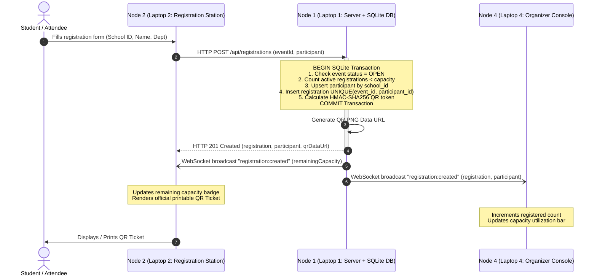
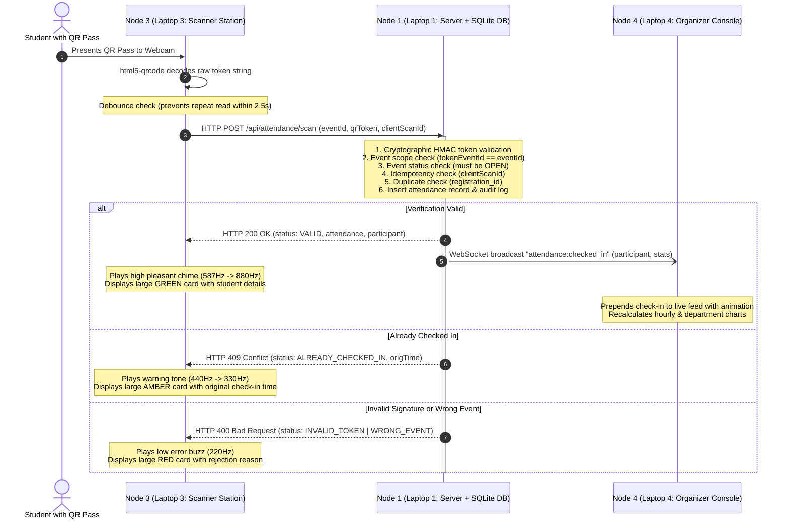
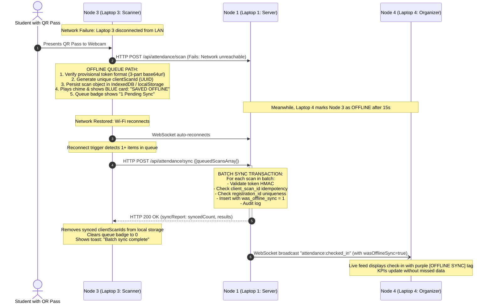
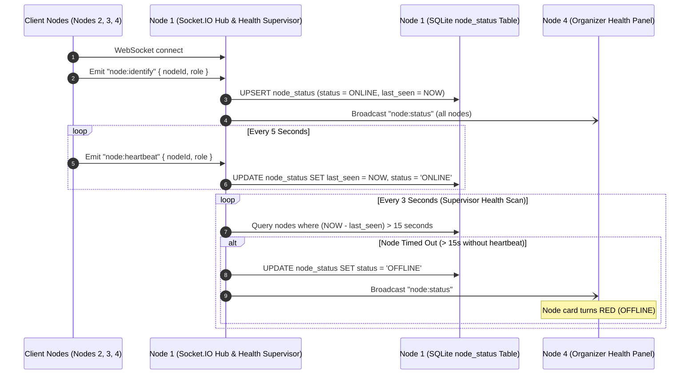

# EventSync: Network Communication & Sequence Flows

This document details the exact network communication sequences across the 4 physical laptops in the EventSync distributed cluster.

---

## 1. Participant Registration Flow (Nodes 2, 1, and 4)

---

## 2. Real-Time QR Check-in Verification Flow (Nodes 3, 1, and 4)

---

## 3. Failure & Recovery: Store-and-Forward Offline Sync Flow

---

## 4. Node Health & Heartbeat Supervision Flow

---

## 6. Authenticated Flows (Login, Self-Registration, Assisted Registration, Scan & Reconnect)

1. **Login Flow:** Client submits `POST /api/auth/login` -> rate-limit check (10 failures / 10 min) -> `bcryptjs` verify -> SQLite `sessions` row created -> `httpOnly` `eventsync_sid` cookie set -> redirected to `/admin` (Administrator) or `/app` (Participant).
2. **Participant Self-Registration:** Participant logs in -> browses `GET /api/events` (only `OPEN` events) -> `POST /api/my/registrations` -> atomic capacity & deadline check -> HMAC QR generated -> `my:registration_updated` emitted to `user:<id>` and `registration:created` emitted to `role:administrator`.
3. **Administrator-Assisted Registration:** Administrator opens `/registration` -> fills participant details (optionally checking "Create participant account with temporary password") -> `POST /api/registrations` records `registered_by_user_id` -> printable QR pass displayed.
4. **QR Scan & Reissue:** Scanner submits `POST /api/attendance/scan` -> verifies HMAC signature, event status (`OPEN`/`ONGOING`), `token_version` match (rejecting reissued old tokens), and double check-in guard -> records `verified_by_user_id` -> broadcasts `attendance:checked_in` to `role:administrator`.
5. **Offline Reconnect & Session Expiry:** If the scanner goes offline, scans are saved in `localStorage`. On reconnect, if the session expired while offline (`401`), the scanner preserves the entire queue and prompts the Administrator to log in at `/login?next=/scanner` before clicking **Sync Queue**.
