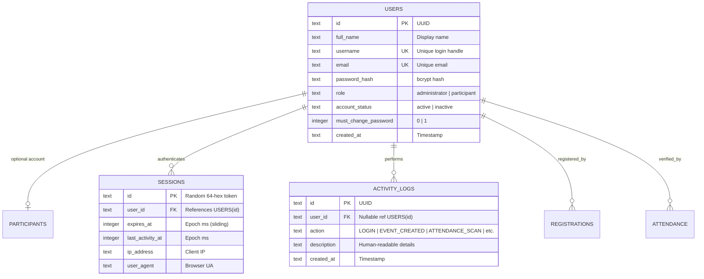

# EventSync: Database Design & Schema Documentation

The authoritative database for EventSync resides strictly on **Node 1 (Laptop 1)**. No other node maintains a direct database connection; all client nodes perform state modifications through the REST API, ensuring that Node 1 remains the authoritative **Single Source of Truth (SSOT)**.

---

## 1. Entity-Relationship Diagram (ERD)

```mermaid
erDiagram
    EVENTS ||--o{ REGISTRATIONS : "has"
    EVENTS ||--o{ ATTENDANCE : "tracks"
    PARTICIPANTS ||--o{ REGISTRATIONS : "enters"
    REGISTRATIONS ||--o| ATTENDANCE : "verifies"
    
    EVENTS {
        text id PK "UUID"
        text title "Event Title"
        text description "Overview"
        text venue "Location"
        text event_date "YYYY-MM-DD"
        text start_time "HH:MM"
        text end_time "HH:MM"
        integer capacity "Total seat limit (>0)"
        text status "DRAFT | OPEN | CLOSED | ENDED"
        integer archived "0 = Active, 1 = Archived"
        text created_at "Timestamp"
    }

    PARTICIPANTS {
        text id PK "UUID"
        text school_id UK "Unique Student/Staff ID"
        text full_name "Full Name"
        text email "Official University Email"
        text department_or_course "Dept / Course"
        text year_level "Year level or title"
        text role "STUDENT | FACULTY | STAFF"
        text created_at "Timestamp"
    }

    REGISTRATIONS {
        text id PK "UUID"
        text event_id FK "References EVENTS(id)"
        text participant_id FK "References PARTICIPANTS(id)"
        text qr_token "HMAC-SHA256 signed token"
        text status "REGISTERED | CANCELLED"
        text registered_at "Timestamp"
        text registered_by_node "e.g. node-2"
    }

    ATTENDANCE {
        text id PK "UUID"
        text registration_id FK_UK "References REGISTRATIONS(id)"
        text event_id FK "References EVENTS(id)"
        text checked_in_at "Timestamp"
        text scanned_by_node "e.g. node-3"
        text client_scan_id UK "Idempotency UUID from client"
        integer was_offline_sync "0 = Realtime, 1 = Offline Queue"
    }

    NODE_STATUS {
        text node_id PK "Unique device ID or node identifier"
        text role "SERVER | REGISTRATION | SCANNER | ORGANIZER"
        text device_type "phone | tablet | laptop"
        text device_name "Friendly name (e.g. Front Desk iPad)"
        text last_seen "Last heartbeat timestamp"
        text status "ONLINE | OFFLINE"
        text ip_address "LAN IPv4 address"
    }

    AUDIT_LOG {
        text id PK "UUID"
        text action "CREATE | REGISTER | CHECK_IN | STATUS_CHANGE"
        text entity "EVENT | REGISTRATION | ATTENDANCE"
        text entity_id "Target entity ID"
        text node_id "Originating cluster node"
        text timestamp "Timestamp"
        text details_json "JSON payload"
    }
```

---

## 2. Table-by-Table Schema Specification

### 2.1 `events` Table
Stores university event schedules and seating capacity.
- `id` (TEXT, PK): Universally Unique Identifier.
- `title` (TEXT, NOT NULL): Official title of the event.
- `description` (TEXT): Detailed description and guidelines.
- `venue` (TEXT, NOT NULL): Physical venue on campus (e.g., "Grand Auditorium").
- `event_date` (TEXT, NOT NULL): Date formatted as `YYYY-MM-DD`.
- `start_time` (TEXT, NOT NULL): Start time formatted as `HH:MM`.
- `end_time` (TEXT, NOT NULL): End time formatted as `HH:MM`.
- `capacity` (INTEGER, NOT NULL): Maximum seating capacity. Enforced by `CHECK(capacity > 0)`.
- `status` (TEXT, NOT NULL): State machine status: `DRAFT`, `OPEN`, `CLOSED`, `ENDED`. Default is `DRAFT`.
- `archived` (INTEGER, NOT NULL): Soft-archive flag (`0` = visible in normal lists, `1` = archived while preserving registrations and attendance). Added with non-destructive migration.
- `created_at` (TEXT, NOT NULL): ISO timestamp.

### 2.2 `participants` Table
Authoritative registry of attendees across events. A participant is uniquely identified by their `school_id`.
- `id` (TEXT, PK): UUID.
- `school_id` (TEXT, UNIQUE, NOT NULL): Student or employee ID (e.g., `2023-10045`).
- `full_name` (TEXT, NOT NULL): Full legal or registered name.
- `email` (TEXT, NOT NULL): University email address.
- `department_or_course` (TEXT, NOT NULL): e.g., "BS Computer Science".
- `year_level` (TEXT, NOT NULL): e.g., "3rd Year", "Associate Professor".
- `role` (TEXT, NOT NULL): `STUDENT`, `FACULTY`, `STAFF`.
- `created_at` (TEXT, NOT NULL): ISO timestamp.

### 2.3 `registrations` Table
Represents an approved ticket reservation for a participant in an event.
- `id` (TEXT, PK): UUID.
- `event_id` (TEXT, FK, NOT NULL): References `events(id) ON DELETE CASCADE`.
- `participant_id` (TEXT, FK, NOT NULL): References `participants(id) ON DELETE CASCADE`.
- `qr_token` (TEXT, NOT NULL): Cryptographically signed token string.
- `status` (TEXT, NOT NULL): `REGISTERED` or `CANCELLED`.
- `registered_at` (TEXT, NOT NULL): ISO timestamp.
- `registered_by_node` (TEXT, NOT NULL): Identifier of the client node (e.g. `node-2`).
- **Constraint `CONSTRAINT uq_event_participant UNIQUE (event_id, participant_id)`**: Guarantees that a participant cannot register more than once for the same event.

### 2.4 `attendance` Table
Immutable ledger of verified attendance scans.
- `id` (TEXT, PK): UUID.
- `registration_id` (TEXT, FK, UNIQUE, NOT NULL): References `registrations(id)`. **The UNIQUE constraint is the database-level lock that mathematically prevents double check-ins.**
- `event_id` (TEXT, FK, NOT NULL): References `events(id)`.
- `checked_in_at` (TEXT, NOT NULL): Official check-in timestamp.
- `scanned_by_node` (TEXT, NOT NULL): Station node ID (e.g. `node-3`).
- `client_scan_id` (TEXT, UNIQUE, NOT NULL): UUID generated by the scanning node at the exact instant of the scan. **Guarantees idempotent offline sync replay.**
- `was_offline_sync` (INTEGER, NOT NULL): Boolean flag (`0` for direct online scans, `1` for scans captured offline and subsequently synchronized).

### 2.5 `node_status` Table
Distributed node registry tracking cluster membership, device hardware, and roles.
- `node_id` (TEXT, PK): Unique device identifier (e.g. `node-1` or generated device UUID).
- `role` (TEXT, NOT NULL): `SERVER`, `REGISTRATION`, `SCANNER`, `ORGANIZER`.
- `device_type` (TEXT, NOT NULL, DEFAULT 'laptop'): Hardware classification (`phone`, `tablet`, `laptop`).
- `device_name` (TEXT): Human-readable device label (e.g. "Front Desk iPad", "Scanner Phone").
- `last_seen` (TEXT, NOT NULL): Heartbeat timestamp.
- `status` (TEXT, NOT NULL): `ONLINE` or `OFFLINE`.
- `ip_address` (TEXT): Detected LAN IPv4 address.

### 2.6 `audit_log` Table
Tamper-evident audit trail of all distributed state transitions.
- `id` (TEXT, PK): UUID.
- `action` (TEXT, NOT NULL): `CREATE`, `UPDATE`, `STATUS_CHANGE`, `REGISTER`, `CHECK_IN`.
- `entity` (TEXT, NOT NULL): `EVENT`, `REGISTRATION`, `ATTENDANCE`.
- `entity_id` (TEXT, NOT NULL): Target primary key.
- `node_id` (TEXT, NOT NULL): Originating node.
- `timestamp` (TEXT, NOT NULL): Timestamp.
- `details_json` (TEXT): Audit details in JSON format.


---

## 3. User Accounts, Sessions & Activity Logging Extensions



### Updated Columns on Existing Tables
- **`events`**: added `category`, `registration_deadline`, and expanded `status` (`DRAFT`, `OPEN`, `ONGOING`, `COMPLETED`, `CANCELLED`, plus legacy `CLOSED`, `ENDED`).
- **`participants`**: added nullable `user_id` (`REFERENCES users(id)`) and `contact_number`. Existing sample participants without accounts remain valid.
- **`registrations`**: added `registered_by_user_id` and `token_version` (incremented on QR reissue to invalidate old tokens).
- **`attendance`**: added `verified_by_user_id` (records which Administrator verified the scan).
